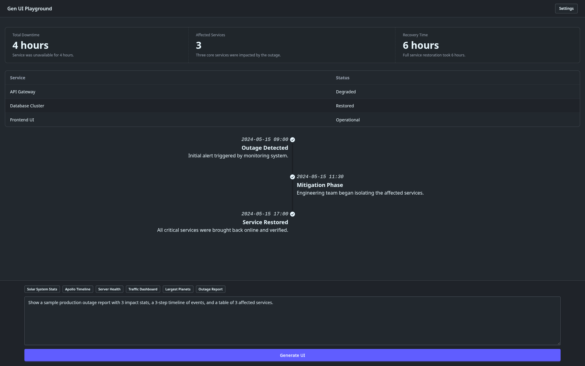
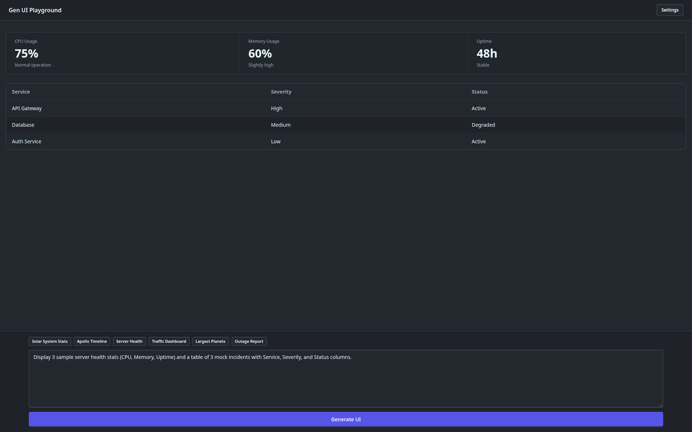

# Gen UI Playground

Experiment with LLM generated UIs

## Demo

| Outage Report | Server Health |
| :---: | :---: |
|  |  |

See more screenshots in the [demo](./demo) folder.

## Getting Started (Live Demo)

1. Navigate to **[https://rumenpetrov.github.io/gen-ui-playground/](https://rumenpetrov.github.io/gen-ui-playground/)**.
2. Click **Open Settings** (or the **Settings** button in the top-right corner) and choose an **API Provider**:
   - **OpenAI-Compatible**:
     - **API URL**: Your local server endpoint (e.g., `http://localhost:1235/v1`)
     - **Model ID**: The model identifier (e.g., `google/gemma-4-e2b`)
   - **Google Gemini**:
     - **API Key**: Your API key from [Google AI Studio](https://aistudio.google.com/apikey)
     - **Model ID**: A Gemini or Gemma model identifier (e.g., `gemini-2.5-flash`)
3. Save your settings and start generating UIs from the prompt bar.

> **Recommendation**: For local inference, we suggest using **LM Studio Bionic** with the `google/gemma-4-e2b` model (make sure **CORS** is enabled in your local server settings so the browser can connect to `localhost`). For cloud inference, use **Google Gemini** with `gemini-2.5-flash`.

## Privacy

Everything you enter or configure stays on your machine. The application runs entirely in your browser, stores settings in your browser's `localStorage`, and communicates directly with your configured LLM provider (either your local server or Google's Gemini API). We do not collect, store, or have access to any data, API keys, or prompts you provide.

## Requirements

- Either a running OpenAI-compatible LLM server (such as LM Studio) or a [Google AI Studio](https://aistudio.google.com/apikey) API key
- Node.js v24+ & npm (only required if running the app locally)

## Tech Stack

- **Framework**: [React 19](https://react.dev/) + [TypeScript](https://www.typescriptlang.org/) + [Vite](https://vite.dev/)
- **Generative UI**: [@openuidev/react-lang](https://www.npmjs.com/package/@openuidev/react-lang) & [@openuidev/lang-core](https://www.npmjs.com/package/@openuidev/lang-core)
- **AI Integration**: [Vercel AI SDK](https://sdk.vercel.ai/) (`ai`, `@ai-sdk/openai-compatible`, & `@ai-sdk/google`) + [Zod](https://zod.dev/)
- **Styling**: [Tailwind CSS v4](https://tailwindcss.com/) + [DaisyUI v5](https://daisyui.com/)
- **Linting**: [Oxlint](https://oxc.rs/)

## Local Development

```bash
npm install
npm run dev
```

## License

See [LICENSE](./LICENSE) for details.
