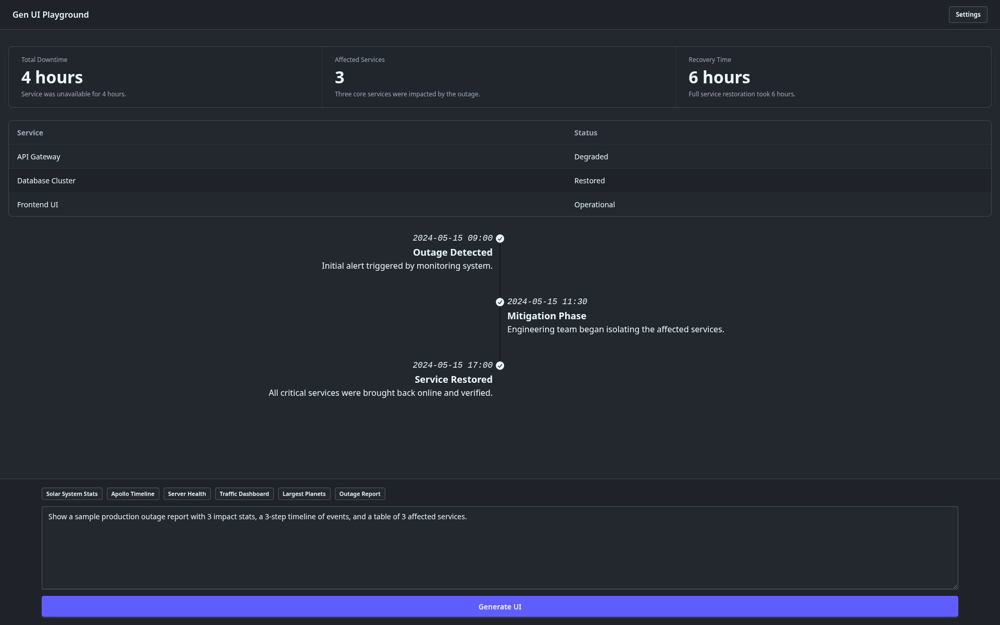
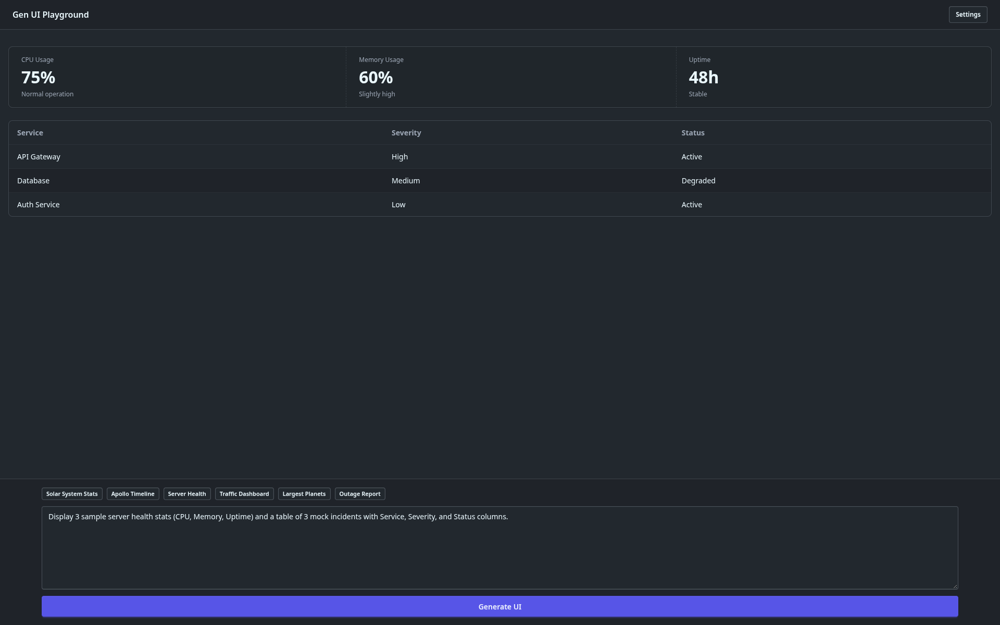

# Gen UI Playground

Experiment with LLM generated UIs

## Demo

| Outage Report | Server Health |
| :---: | :---: |
|  |  |

See more screenshots in the [demo](./demo) folder.

## Getting Started (Live Demo)

1. Navigate to **[https://rumenpetrov.github.io/gen-ui-playground/](https://rumenpetrov.github.io/gen-ui-playground/)**.
2. Click **Open Settings** (or the **Settings** button in the top-right corner) to configure an OpenAI-compatible LLM API:
   - **API URL**: Your local server endpoint (e.g., `http://localhost:1235/v1`)
   - **Model ID**: The model identifier (e.g., `google/gemma-4-e2b`)
3. Save your settings and start generating UIs from the prompt bar.

> **Recommendation**: We suggest using **LM Studio Bionic** with the `google/gemma-4-e2b` model. Make sure **CORS** is enabled in your local server settings so the browser can connect to `localhost`.

## Privacy

Everything you enter or configure stays on your machine. The application runs entirely in your browser, stores settings in your browser's `localStorage`, and communicates directly with your configured LLM endpoint. We do not collect, store, or have access to any data or prompts you provide.

## Requirements

- A running OpenAI-compatible LLM server (such as LM Studio)
- Node.js v24+ & npm (only required if running the app locally)

## Tech Stack

- **Framework**: [React 19](https://react.dev/) + [TypeScript](https://www.typescriptlang.org/) + [Vite](https://vite.dev/)
- **Generative UI**: [@openuidev/react-lang](https://www.npmjs.com/package/@openuidev/react-lang) & [@openuidev/lang-core](https://www.npmjs.com/package/@openuidev/lang-core)
- **AI Integration**: [Vercel AI SDK](https://sdk.vercel.ai/) (`ai` & `@ai-sdk/openai-compatible`) + [Zod](https://zod.dev/)
- **Styling**: [Tailwind CSS v4](https://tailwindcss.com/) + [DaisyUI v5](https://daisyui.com/)
- **Linting**: [Oxlint](https://oxc.rs/)

## Local Development

```bash
npm install
npm run dev
```

## License

See [LICENSE](./LICENSE) for details.
